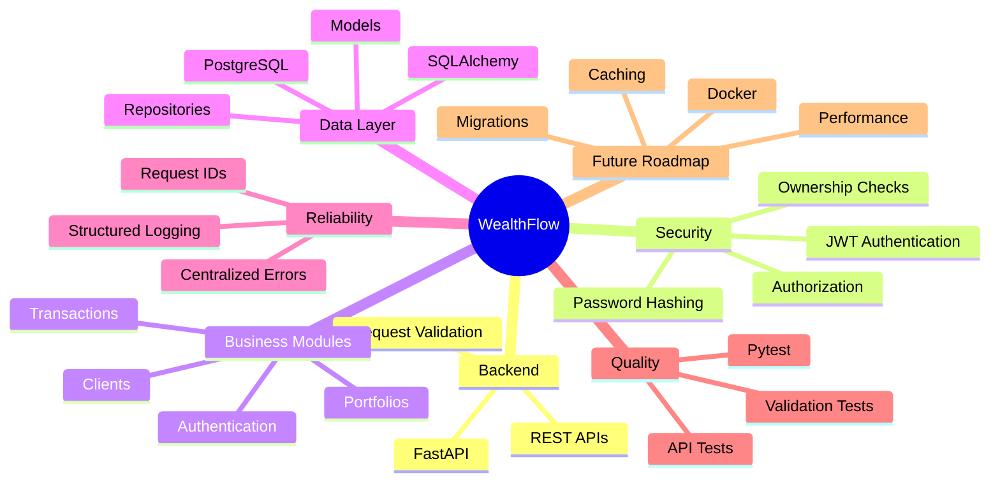
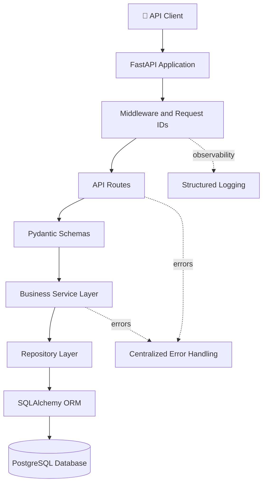
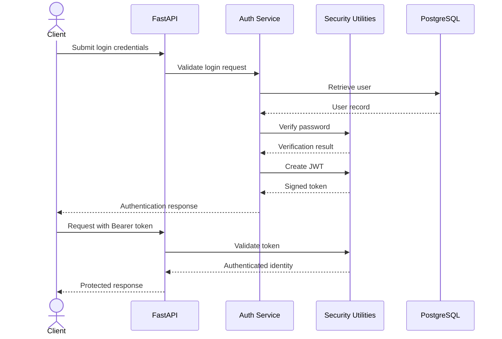
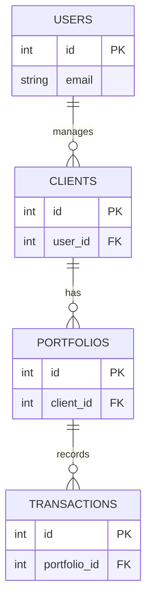
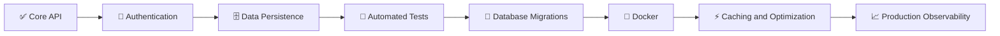

# 💹 WealthFlow
### A Secure, Modular Wealth Management Backend

<p align="center">
  <strong>Manage clients, portfolios, transactions, and financial data through a structured REST API.</strong>
</p>

<p align="center">
  
  
  
  
  
  
</p>

---

## 🌟 Overview

**WealthFlow** is a backend application designed to support core wealth management workflows through modular APIs and a relational database.

The project focuses on clean backend architecture, secure authentication, data validation, separation of business logic, centralized error handling, and automated testing.

Rather than placing all application logic inside a single file, WealthFlow separates API routes, business services, repositories, database models, schemas, and shared infrastructure into dedicated modules.

### ✨ Key Features

- 🔐 **Authentication and security** — JWT-based authentication and password hashing.
- 👥 **Client management** — Structured client data and ownership-aware operations.
- 📊 **Portfolio management** — Portfolio records and summary-oriented workflows.
- 💳 **Transaction management** — Structured transaction operations and validation.
- 🗄️ **Relational persistence** — PostgreSQL with SQLAlchemy.
- 🧩 **Layered architecture** — Separation of API, service, repository, and database responsibilities.
- 🛡️ **Centralized error handling** — Consistent application-level exception handling.
- 📝 **Request observability** — Structured logging and request ID middleware.
- 🧪 **Automated testing** — Pytest-based tests covering authentication, health checks, errors, validation, and portfolio summaries.

---

## 🧠 WealthFlow Mind Map



---

## 🏗️ System Architecture

WealthFlow uses a layered architecture that separates incoming HTTP requests from business rules and database operations.



### 🔍 How a Request Flows

1. A client sends an HTTP request to the FastAPI application.
2. Middleware adds request context and supports request tracing.
3. An API route receives the request and validates its input.
4. The service layer applies business rules.
5. The repository layer performs data-access operations.
6. SQLAlchemy communicates with PostgreSQL.
7. The API returns a structured response or handles an appropriate error.

**Design principle:** API routes should coordinate requests, services should own business logic, and repositories should handle data access.

---

## 🧩 Project Structure

```text
wealthflow/
│
├── main.py
│
├── app/
│   ├── __init__.py
│   │
│   ├── api/
│   │   └── __init__.py
│   │
│   ├── core/
│   │   ├── config.py
│   │   ├── dependencies.py
│   │   ├── logging_config.py
│   │   ├── request_context.py
│   │   └── security.py
│   │
│   ├── database/
│   │   └── database.py
│   │
│   ├── exceptions/
│   │   ├── exceptions.py
│   │   └── handlers.py
│   │
│   ├── middleware/
│   │   └── request_id.py
│   │
│   ├── models/
│   │   ├── client.py
│   │   ├── portfolio.py
│   │   ├── transaction.py
│   │   └── user.py
│   │
│   ├── repositories/
│   │   ├── client_repository.py
│   │   ├── portfolio_repository.py
│   │   ├── transaction_repository.py
│   │   └── user_repository.py
│   │
│   ├── schemas/
│   │   ├── auth.py
│   │   ├── client.py
│   │   ├── portfolio.py
│   │   └── transaction.py
│   │
│   └── services/
│       ├── auth_service.py
│       ├── client_service.py
│       ├── portfolio_service.py
│       └── transaction_service.py
│
├── tests/
│   ├── conftest.py
│   ├── test_auth.py
│   ├── test_errors.py
│   ├── test_health.py
│   ├── test_portfolio_summary.py
│   └── test_validation.py
│
└── .gitignore
```

*Note: The tree highlights the modules currently present in the project. Add dependency manifests, migrations, and other files as they are introduced.*

---

## 🔐 Authentication and Request Lifecycle



The diagram represents the intended authentication flow. Actual route names, response formats, token-expiry behavior, and authorization rules should be verified against the implementation.

---

## 🗃️ Core Domain Model



This is a **conceptual relationship diagram**, not a verified database schema. Confirm actual foreign keys, cardinalities, and column names in the SQLAlchemy models before treating it as the exact schema.

---

## 🛠️ Technology Stack

| Technology | Purpose |
|---|---|
| Python | Backend programming |
| FastAPI | REST API framework |
| PostgreSQL | Relational database |
| SQLAlchemy | ORM and database access |
| Pydantic | Request and data validation |
| JWT | Token-based authentication |
| Password hashing | Secure password verification |
| Pytest | Automated testing |
| Git and GitHub | Version control |

---

## 🚀 Getting Started

### Prerequisites

- Python installed on your machine
- PostgreSQL
- Git
- A terminal or code editor

### 1. Clone the repository

```bash
git clone https://github.com/Harinath125/wealthflow.git
cd wealthflow
```

### 2. Create and activate a virtual environment

On macOS:

```bash
python3 -m venv .venv
source .venv/bin/activate
```

### 3. Install dependencies

If a `requirements.txt` file is available:

```bash
pip install -r requirements.txt
```

Otherwise, install the packages listed in your project's dependency configuration. Ensure your installed versions are compatible with your Python version.

### 4. Configure PostgreSQL

Create a PostgreSQL database named `wealthflow` if it does not already exist.

For a local PostgreSQL installation managed by Homebrew:

```bash
brew services start postgresql@14
createdb wealthflow
```

If the database already exists, do not create it again. Use your application's existing configuration for the database URL and credentials.

### 5. Configure environment variables

Review `app/core/config.py` to determine the exact environment variable names expected by the application.

Configure your local environment with the appropriate database connection details, JWT settings, and other required secrets.

**Security:** Keep `.env` and all real credentials out of Git. Never publish production secrets.

### 6. Start the application

If your entry point exposes the FastAPI application as `app` in `main.py`, run:

```bash
uvicorn main:app --reload
```

The development server will normally be available at:

- Application: http://127.0.0.1:8000
- Interactive Swagger documentation: http://127.0.0.1:8000/docs
- ReDoc documentation: http://127.0.0.1:8000/redoc

### 7. Run the tests

```bash
python -m pytest -v
```

Run the test suite before submitting changes or deploying the application.

---

## 🧪 Testing Strategy

The existing test suite is organized around key backend responsibilities:

| Test module | Focus |
|---|---|
| `test_auth.py` | Authentication behavior |
| `test_errors.py` | Error handling |
| `test_health.py` | Health endpoints |
| `test_portfolio_summary.py` | Portfolio summary behavior |
| `test_validation.py` | Input validation |
| `conftest.py` | Shared test configuration and fixtures |

Tests should also be extended as the application evolves to cover database failures, authorization boundaries, transaction consistency, and edge cases.

---

## 🗺️ Development Roadmap



### Planned Improvements

- [ ] Add and standardize database migrations with Alembic.
- [ ] Improve automated test coverage and integration testing.
- [ ] Add Docker-based development and deployment.
- [ ] Strengthen database transaction management and integrity checks.
- [ ] Evaluate caching and query optimization.
- [ ] Improve production logging, metrics, and monitoring.
- [ ] Add load and performance testing.
- [ ] Evaluate background jobs and asynchronous processing where appropriate.
- [ ] Document API contracts, configuration, and deployment procedures.

These are roadmap items, not claims that the functionality is already implemented.

---

## 🎯 Engineering Principles

WealthFlow is developed around several backend engineering principles:

- **Separation of concerns:** Each layer has a clearly defined responsibility.
- **Security by design:** Authentication, authorization, and credential management matter from the beginning.
- **Maintainability:** Small, focused modules make the code easier to test and extend.
- **Reliability:** Validation, consistent error handling, and tests help prevent regressions.
- **Observability:** Request IDs and structured logs help trace application behavior.
- **Incremental development:** New capabilities should be added with appropriate tests and documentation.

---

## 👨‍💻 Author

**Rayala Harinath**

B.Tech Computer Science & Engineering

GitHub: [@Harinath125](https://github.com/Harinath125)

LinkedIn: [Rayala Harinath](https://linkedin.com/in/rayala-harinath-853300303)

---

## ⭐ Support

If you find this project useful, consider giving the repository a star ⭐.

*WealthFlow is a software engineering project intended to demonstrate backend architecture and wealth-management workflows. It is not financial advice or a production-ready investment platform.*
